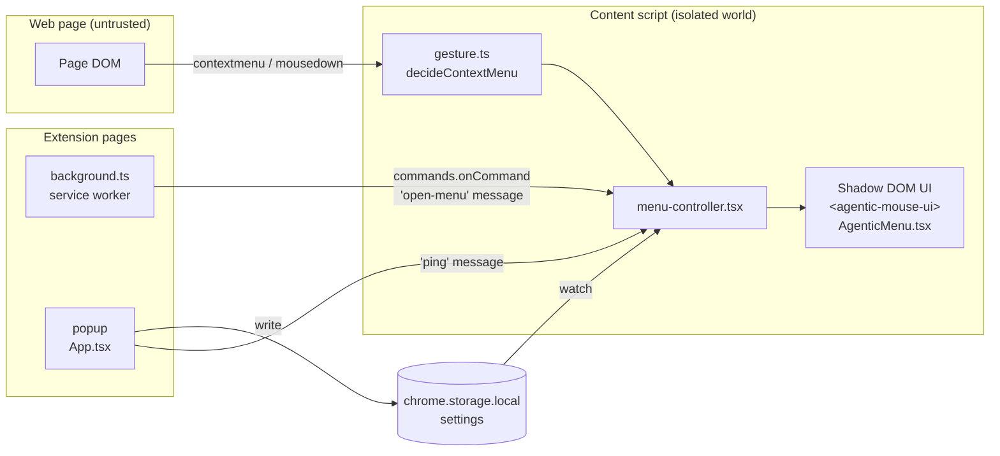

# Architecture

Agentic Mouse is a Chrome MV3 extension built with [WXT](https://wxt.dev), React 19, and
TypeScript (strict). This document describes the runtime pieces, module boundaries, data
contracts, and the paths to future capabilities (Go backend, shared packages).

## Runtime overview



| Piece             | File(s)                                        | Responsibility                                                                       |
| ----------------- | ---------------------------------------------- | ------------------------------------------------------------------------------------ |
| Content script    | `src/entrypoints/content/index.tsx`            | Entry; runs on `http(s)://*/*`, top frame only, `document_idle`.                     |
| Menu controller   | `src/content/menu-controller.tsx`              | Gesture handling, open/close lifecycle, dismissal listeners, shortcut/ping messages. |
| Gesture decision  | `src/content/gesture.ts`                       | Pure: who handles a `contextmenu` (native vs. Agentic Mouse) given settings.         |
| Positioning       | `src/content/positioning.ts`                   | Pure: viewport-aware placement (flip + clamp).                                       |
| Invocation        | `src/content/invocation.ts`                    | Cheap snapshot of what was clicked (`MenuInvocation`). Seam for Workstream A.        |
| Menu UI           | `src/content/menu/AgenticMenu.tsx`, `menu.css` | Renders resolved actions; keyboard nav; "coming soon" notices.                       |
| Background        | `src/entrypoints/background.ts`                | Install defaults, badge, task orchestration, Cursor polling, fallback shortcut.      |
| Popup             | `src/entrypoints/popup/*`, `src/popup/*`       | Toggle, page status, Inbox (tasks + walking cat), Agents settings, pinned actions.   |
| Tasks             | `src/core/tasks/*`, `src/background/tasks/*`   | Pure state machine + persisted TaskStore, alarms, completion notifications.          |
| Destinations      | `src/background/destinations/*`                | Cursor Cloud Agent adapter, prefill-link, clipboard handoff.                         |
| Contracts         | `src/core/contracts/*`                         | Zod schemas + inferred types for every cross-module data shape.                      |
| Action registry   | `src/core/actions/*`                           | Catalog of action definitions; executors register to become available.               |
| Platform adapters | `src/platform/*`                               | Thin wrappers over `browser.*` (settings storage, tab status, badge).                |

## Module boundaries

```
src/
  core/        Framework- and browser-API-free. Contracts, registry, pure logic, metrics.
               ESLint forbids importing react / react-dom / wxt here.
  platform/    The only place (besides entrypoints/UI hooks) that touches browser.* APIs.
  content/     Content-script runtime: DOM, Shadow DOM UI, gesture handling.
  popup/       Popup React UI.
  entrypoints/ WXT entrypoints. Thin: wire modules together, no business logic.
tests/e2e/     Playwright tests against the built extension in real Chromium.
```

Rules:

1. `core` depends on nothing but `zod`. Anything in `core` must be usable from a future Go
   service's TypeScript client, a web dashboard, or tests without a browser.
2. UI never constructs data shapes ad hoc: it consumes types from `core/contracts`.
3. Browser APIs are imported from `wxt/browser` (never the raw `chrome` global; ESLint enforces
   this in `src/`), which keeps code testable with WXT's `fakeBrowser`.

## The gesture path (performance-critical)

On every `contextmenu` event the controller does, synchronously:

1. `decideContextMenu(event, settings)` — two boolean checks against cached settings.
2. If Agentic Mouse handles it: `preventDefault()` + `stopImmediatePropagation()`, snapshot the
   invocation (`detectQuickTargetKind`: selection/link/image/element — no tree walks), mount the
   Shadow DOM host, render, measure, position in a layout effect before paint.

No storage reads, network calls, LLM calls, or DOM-wide scans happen in this path. Settings are
loaded once at startup and kept fresh via `storage.watch`. If settings or the UI are not ready
yet, the decision **fails open to the native menu**.

A matching right-button `mousedown` has only its default cancelled (it still propagates), so
Shift + click does not extend the page's text selection.

Dismissal listeners (`keydown` Escape, outside `pointerdown`, window `blur`/`resize`, page
`scroll`) are attached **only while the menu is open** and removed on close. When idle the
extension adds just two capture-phase listeners (`contextmenu`, `mousedown`) that return
immediately unless the gesture matches.

Latency from the input event's timestamp to positioned menu is recorded locally as
`menu.open` (`core/metrics.ts`) and exposed on the menu element as `data-open-latency-ms`.

## Style and event isolation

- The menu renders inside a Shadow DOM created by WXT's `createShadowRootUi`
  (`cssInjectionMode: 'ui'`, `:host { all: initial }`), appended to `<html>` (not `<body>`, so
  a transformed body cannot break `position: fixed`).
- The host element gets inline `!important` positioning so page stylesheets cannot hide or
  displace it. All menu typography is set explicitly; nothing relies on inheritance.
- `isolateEvents` stops keyboard, pointer, and click events from bubbling out of the shadow
  root, so page shortcuts and "click outside" handlers do not react to menu interaction.
- The shadow root is `open` so Playwright can test it. Before rendering any sensitive data
  (e.g. API responses tied to credentials) revisit `closed` mode; see Known limitations.

## Data contracts

All contracts live in `src/core/contracts/` as Zod schemas with inferred TypeScript types.
Variants use **discriminated unions** so consumers get exhaustive `switch` checking
(`@typescript-eslint/switch-exhaustiveness-check` is on).

| Contract                | Discriminant  | Purpose                                                                                                 |
| ----------------------- | ------------- | ------------------------------------------------------------------------------------------------------- |
| `ActionId`              | enum          | The 12 V1 actions.                                                                                      |
| `ActionDefinition`      | —             | Static metadata: label, category, `dataEgress`, `presentation`.                                         |
| `ActionAvailability`    | `status`      | `available` / `coming-soon` / `blocked` (derived by the registry).                                      |
| `ActionInput`           | `actionId`    | Per-action input; one variant per `ActionId` (enforced by a unit test).                                 |
| `SelectedContext`       | —             | `untrusted: true`, source metadata, `SelectionTarget`, page classification, sensitivity.                |
| `SelectionTarget`       | `kind`        | `text-selection` / `element` / `page` / `link` / `image`.                                               |
| `ContentBlock`          | `type`        | Structure-preserving extraction: heading, paragraph, list, table, code, quote, image, link.             |
| `PageClassification`    | `kind`        | article / documentation / github-issue / product / listing / generic, with facets.                      |
| `ElementClassification` | —             | Element kind, confidence, signals, `sensitive`.                                                         |
| `AgentDestination`      | `integration` | `cursor-cloud-agent` (background-execution) / `prefill-link` (prefill-only) / `clipboard`.              |
| `TaskRequest`           | —             | Input + `TaskExecutor` + `TaskApproval`. Only background-capable destinations are allowed.              |
| `TaskState`             | `status`      | queued / running (determinate or indeterminate progress) / monitoring / completed / failed / cancelled. |
| `ActionResult`          | `kind`        | inline-text / selection / table / comparison / handoff / tracking / unavailable.                        |
| `ActionEvent`           | `type`        | Streamed executor events: progress / text-delta / task-created / result / error.                        |
| `Settings`              | —             | `enabled`, `triggerMode`, `pinnedActionIds` (versioned; parsed defensively per field).                  |
| `DestinationsConfig`    | —             | Destinations, saved actions, trusted rules (versioned; separate from credentials).                      |
| `TaskEvent`             | `type`        | Pure state-machine inputs (`start`, `progress`, `complete`, …).                                         |
| `BackgroundRequest`     | `type`        | Content/popup → background (task create, handoff, inbox commands, credential status).                   |
| `ContentScriptMessage`  | `type`        | Extension-internal messages (`ping`, `open-menu`), validated on receipt.                                |

Validation happens at trust boundaries: storage reads (`parseSettings`), incoming extension
messages, and (in future) network responses and anything derived from page content.

## Action registry and executors

```ts
interface ActionExecutor<A extends ActionId> {
  readonly actionId: A;
  execute(input: ActionInputFor<A>, signal: AbortSignal): AsyncIterable<ActionEvent>;
}
const registry = createActionRegistry({ executors: [explainExecutor] });
registry.resolve(settings.pinnedActionIds); // → [{ definition, availability }]
```

- The menu renders whatever `registry.resolve(pinnedIds)` returns. It has no knowledge of
  individual actions, so adding an action never touches the menu.
- Availability is derived: an action with a registered executor is `available`; otherwise it is
  `coming-soon` and the menu explains that instead of pretending to run it.
- Adding an action: add its id to `ACTION_IDS`, its input variant to `ActionInputSchema`, its
  definition to `ACTION_CATALOG` (the `satisfies` clause and unit tests fail until all three
  exist), then register an executor when it works.

## Persistence

Settings are stored in `chrome.storage.local` under `settings` via WXT's storage wrapper
(`src/platform/settings-store.ts`). Writes are validated (`SettingsSchema.parse`); reads are
repaired field by field so a bad value never wipes other preferences. `chrome.storage.local`
is chosen over `sync` for now to keep behavior deterministic in tests; moving to `sync` is a
one-line change once quota behavior is considered.

## Security model

- **Webpage content is untrusted data.** `SelectedContext.untrusted` is a literal `true` so no
  code path can forget it. Executors must place page content in clearly delimited data sections
  of prompts and never let it alter the selected action, destination, or approval.
- **Credentials never touch content scripts or pages.** Future API tokens (e.g. Cursor) live in
  extension storage and are used only from the background service worker. Content scripts ask
  the background to act via validated messages.
- **Consequential actions need approval.** `TaskRequest.approval` is required; `trusted-rule`
  approvals reference revocable site-agent rules.
- **Sensitive fields** (passwords, payment, OTP) are flagged at classification time and blocked
  from external egress.
- **Messages are validated** with Zod even though pages cannot send extension messages.

## Permissions

| Permission / access                       | Why                                                                                                                                                                                     |
| ----------------------------------------- | --------------------------------------------------------------------------------------------------------------------------------------------------------------------------------------- |
| `storage`                                 | Persist settings, destinations, tasks/trackers, and credentials (credentials never leave the background). Model API keys are stored separately from Cursor credentials.                 |
| `alarms`                                  | Poll Cursor Cloud Agent run status while the MV3 service worker is suspended, and schedule Workstream C Track checks.                                                                   |
| `notifications`                           | One completion/failure notification per agent task, plus Track condition-met alerts (honors notification preferences).                                                                  |
| Content script on `http(s)://*/*`         | The Shift + right-click listener must already be present when the user right-clicks. `activeTab` + on-demand injection would require clicking the toolbar first, defeating the product. |
| `commands`                                | Manifest key (no permission prompt) for the fallback shortcut.                                                                                                                          |
| Optional host `https://api.cursor.com/*`  | Requested when the user saves a Cursor API key; used only by the background adapter.                                                                                                    |
| Optional `https://openrouter.ai/*`        | Requested only when the user configures OpenRouter for inline AI. Used solely by the background service worker.                                                                         |
| `optional_host_permissions` http(s)://_/_ | Requested per tracked origin at Track start so the service worker can fetch the page when no tab is open. Open-tab checks use the content script and need no extra host access.         |

No `tabs` / `scripting` / broad required host permission beyond the content script, and no remote code.
API keys never leave background/storage; content scripts receive only `apiKeyConfigured` / destination status flags.

## Testing strategy

| Layer       | Tool                                   | What it proves                                                                                                                                    |
| ----------- | -------------------------------------- | ------------------------------------------------------------------------------------------------------------------------------------------------- |
| Unit        | Vitest + happy-dom + WXT `fakeBrowser` | Contracts, registry, pinned ops, positioning math, gesture decision, menu component, storage logic. Browser APIs are **mocked**.                  |
| Integration | Playwright + Chromium + unpacked build | Real extension in real Chromium: gesture interception, dismissal, isolation, popup toggle, persistence across browser restart, unsupported pages. |
| Manual      | Chrome                                 | Native context-menu rendering, real keyboard shortcut, Chrome Web Store page, OS-specific behavior.                                               |

See the README for what Playwright cannot validate.

## Future direction

- **Go backend** (`server/` or `services/tasks/` when introduced): durable task API and
  orchestration, PostgreSQL for task state. The extension talks to it only from the background
  service worker. Contracts in `src/core/contracts` are the source of truth; generate JSON
  Schema from Zod (`z.toJSONSchema`) for Go code generation rather than hand-maintaining twins.
- **Shared packages**: when a second consumer (web dashboard, backend client) appears, move
  `src/core` to `packages/core` in a pnpm workspace. `core` already has no browser or UI
  dependencies, so this is a file move plus import-path update.
- **Observation/task patterns** inspired by Perch-Pulse, Free Agents, and OneMCP plug in as
  `ActionExecutor`s and `TaskExecutor` kinds without changing the menu or popup.
